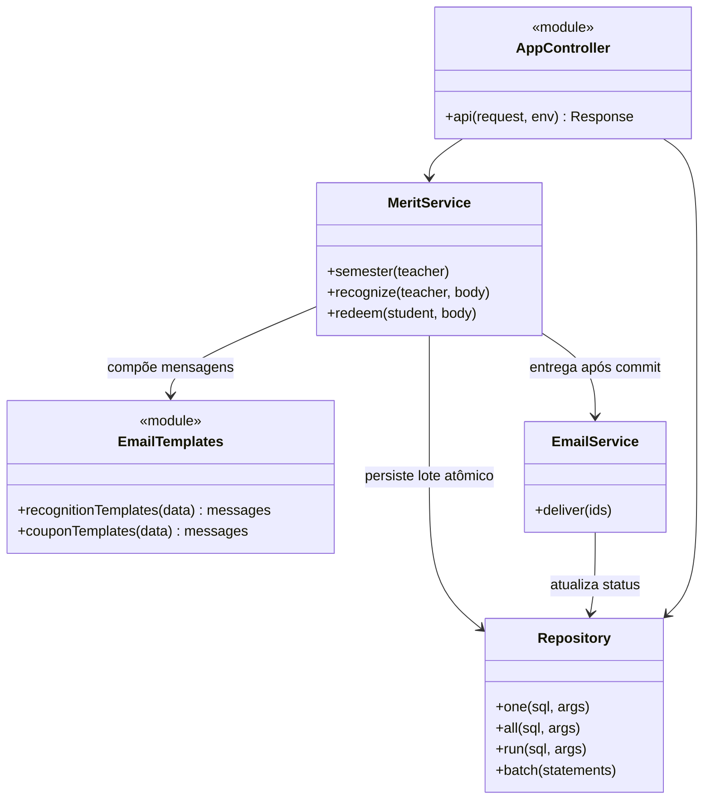
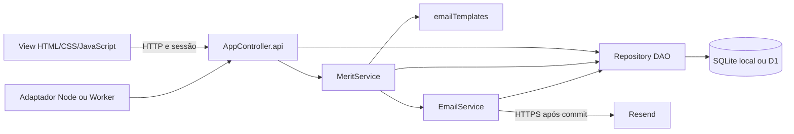

# Modelos da Release 2

## Comparação com a Release 1

| Modelo anterior | Alteração da Release 2 | Correspondência com o código |
|---|---|---|
| Reconhecimento gerava uma notificação para o aluno | Gera duas, com confirmação do professor e recebimento do aluno | `MeritService.recognize` grava transação e duas linhas de `emails` no mesmo `batch` |
| Texto de e-mail construído dentro de `MeritService` | Templates centralizados por destinatário | Módulo `emailTemplates.mjs` com `recognitionTemplates` e `couponTemplates` |
| Cupom usava o mesmo corpo para ambos os destinatários | Instruções específicas de apresentação e conferência, mantendo o código comum | `couponTemplates` retorna duas mensagens |
| Classes, componentes, casos de uso e ER da Release 1 | Sequências individuais e geral adicionadas | [Diagramas de sequência](sequencias/README.md), com rotas e métodos reais |

O [modelo conceitual de classes](../sprints/03/classes.mmd) e o [modelo ER](../sprints/03/modelo-er.mmd) continuam válidos: não foram criadas entidades nem colunas. Cada transação já se relaciona a zero ou mais notificações. Os perfis Aluno/Professor/Empresa continuam registros de `users` diferenciados por `role`, sem classes de domínio artificiais. Os modelos da Release 1 foram preservados em suas pastas.

## Classes e módulos efetivos

## Componentes MVC

As rotas de CRUD e leitura usam diretamente `Repository`; os serviços encapsulam as operações de moedas e entrega de e-mail. O controlador também continua usando o módulo de segurança e o seed conforme a [arquitetura geral](../ARQUITETURA.md).
