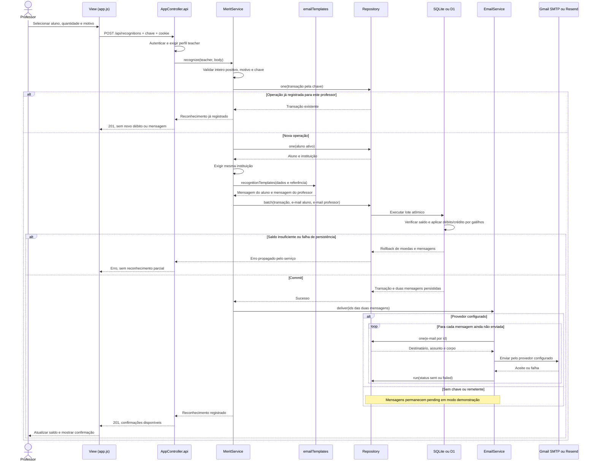
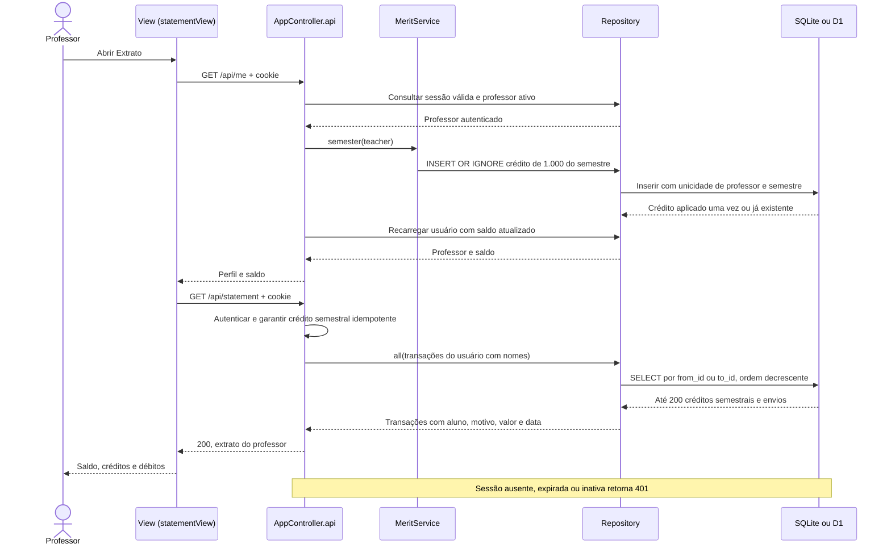
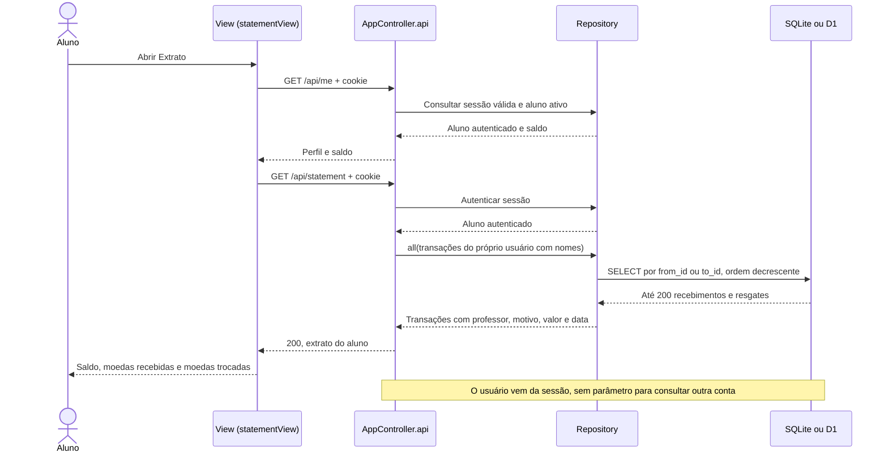
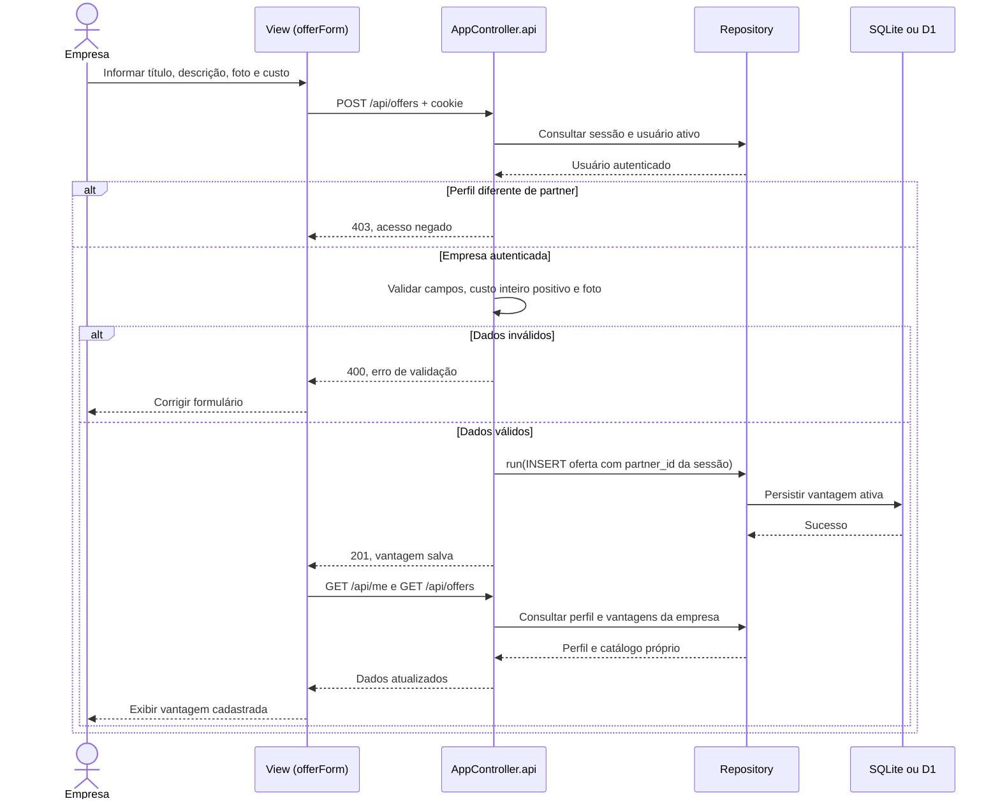
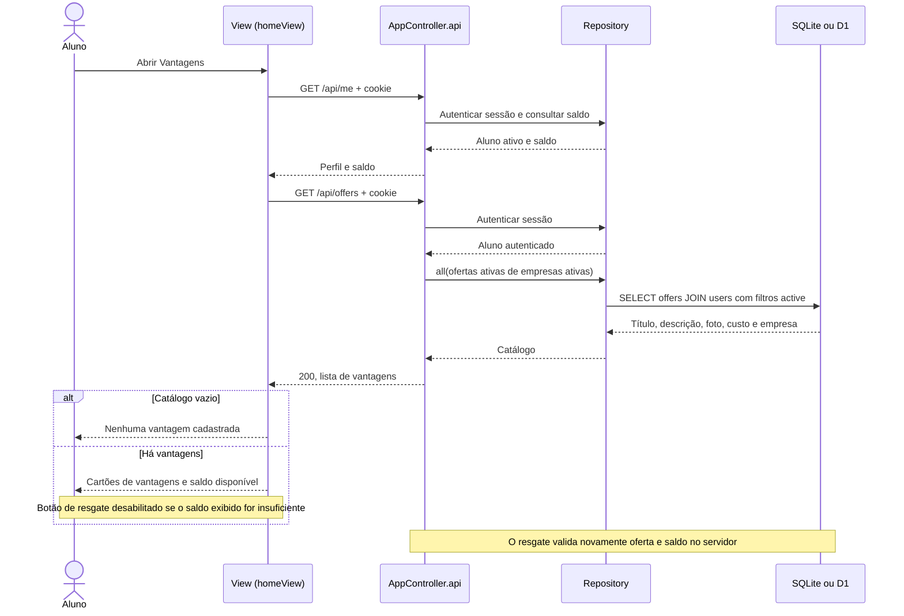
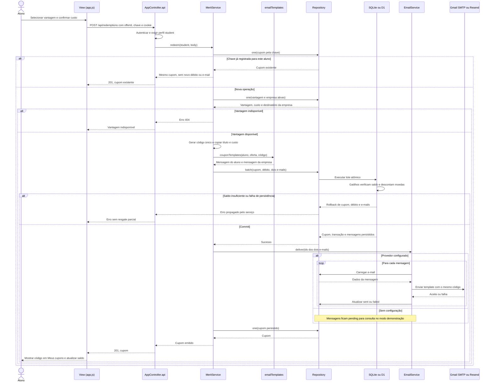
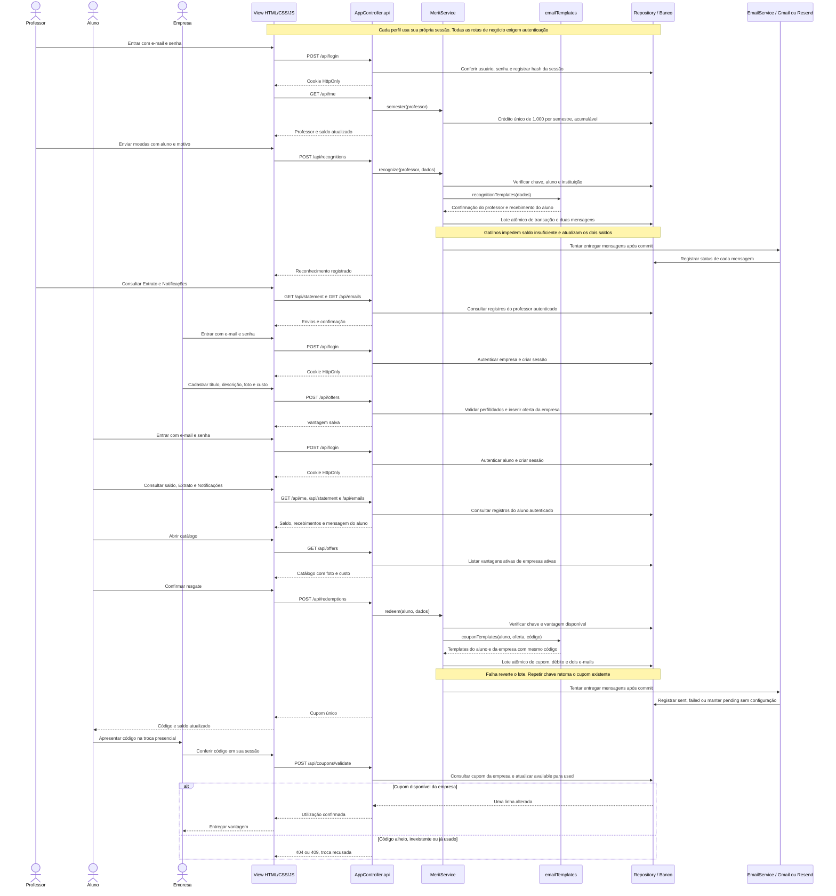

# Diagramas de sequência da Release 2

Um diagrama para cada um dos seis casos de uso desta continuação (consultas de professor e aluno representadas separadamente) e um diagrama geral. Cada arquivo `.mmd` pode ser aberto em um visualizador Mermaid; as mesmas sequências são exibidas abaixo no GitHub.

Cadastro de usuários, login, manutenção de perfis e conferência de cupom continuam descritos nos [casos de uso da Release 1](../../sprints/03/casos-de-uso.md). O login e a conferência também aparecem na sequência geral como apoio aos fluxos da Release 2.

O controlador valida origem, sessão e usuário ativo antes das rotas de negócio. Em cada requisição autenticada de professor, garante o crédito semestral idempotente. Esses passos comuns são resumidos quando não são o foco do diagrama. Os lotes usam `Repository.batch`, transação SQLite no adaptador local e batch atômico no D1. Falhas de entrega após o commit não desfazem moedas nem cupons. Sem configuração, a outbox permanece pendente.

- [Enviar moedas](#enviar-moedas)
- [Consultar extrato do professor](#consultar-extrato-do-professor)
- [Consultar extrato do aluno](#consultar-extrato-do-aluno)
- [Cadastrar vantagem](#cadastrar-vantagem)
- [Listar vantagens](#listar-vantagens)
- [Trocar vantagem](#trocar-vantagem)
- [Sequência geral](#sequência-geral)

## Enviar moedas

Lab04S01: confirmação de envio para professor e recebimento para aluno. [Arquivo Mermaid](enviar-moedas.mmd).

## Consultar extrato do professor

Lab04S01: saldo, crédito semestral e envios. [Arquivo Mermaid](extrato-professor.mmd).

## Consultar extrato do aluno

Lab04S01: saldo, recebimentos e trocas. [Arquivo Mermaid](extrato-aluno.mmd).

## Cadastrar vantagem

Lab04S02: empresa autenticada e campos obrigatórios. [Arquivo Mermaid](cadastrar-vantagem.mmd).

## Listar vantagens

Lab04S02: catálogo ativo para o aluno. [Arquivo Mermaid](listar-vantagens.mmd).

## Trocar vantagem

Lab04S03: débito atômico, cupom e dois e-mails. [Arquivo Mermaid](trocar-vantagem.mmd).

## Sequência geral

Lab04S03: colaboração entre os três perfis, do reconhecimento à troca presencial. [Arquivo Mermaid](geral.mmd).

