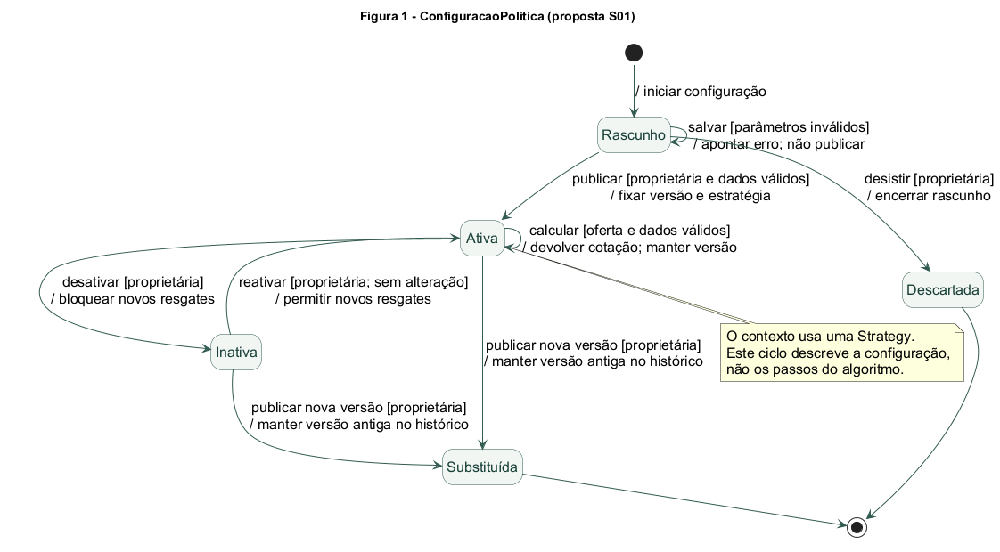
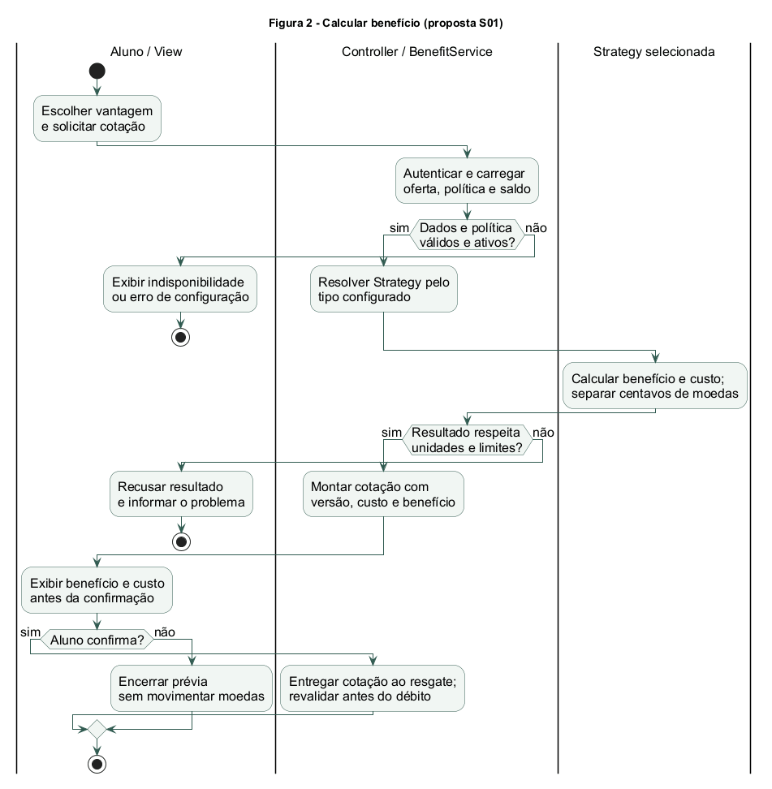
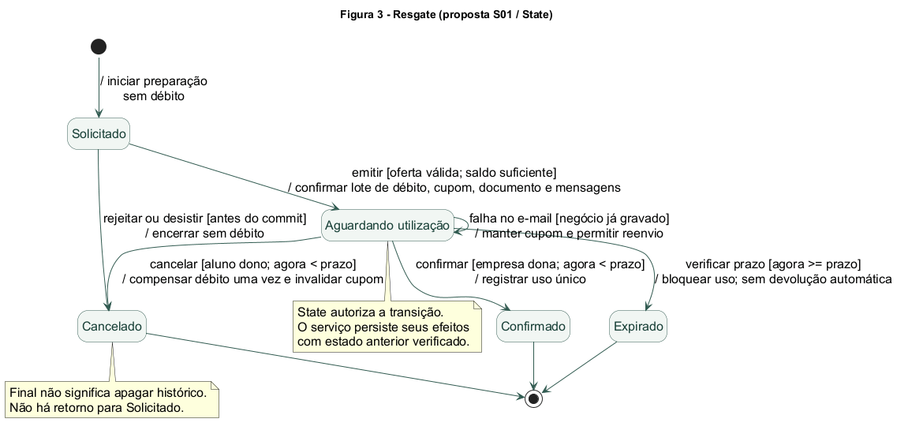
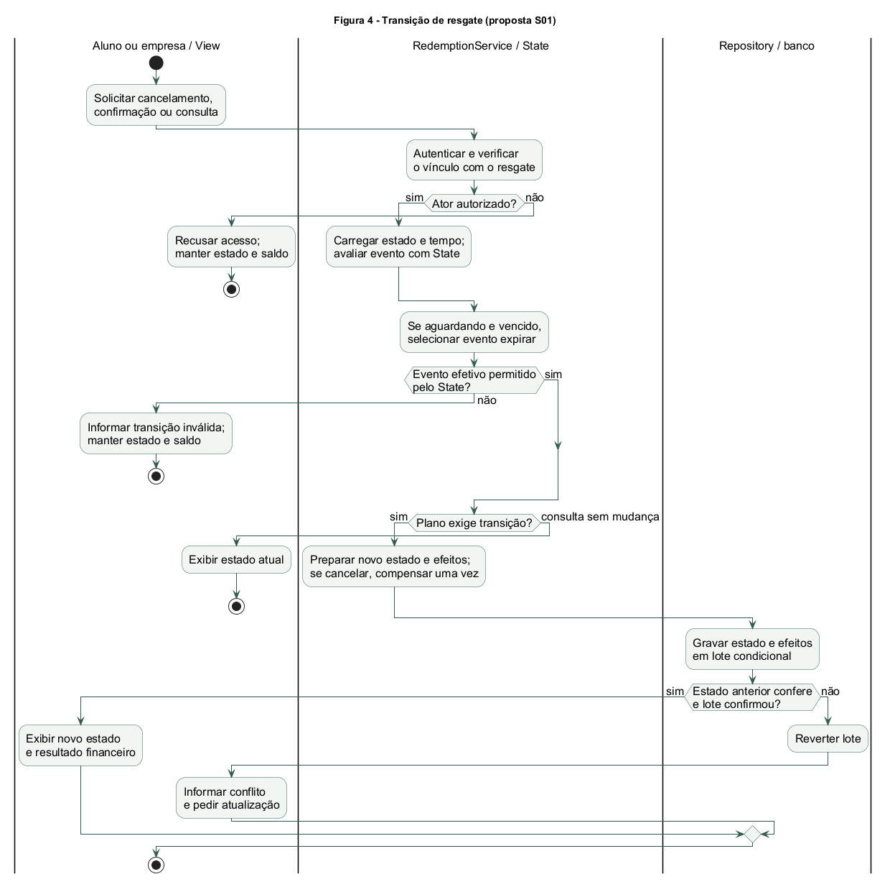
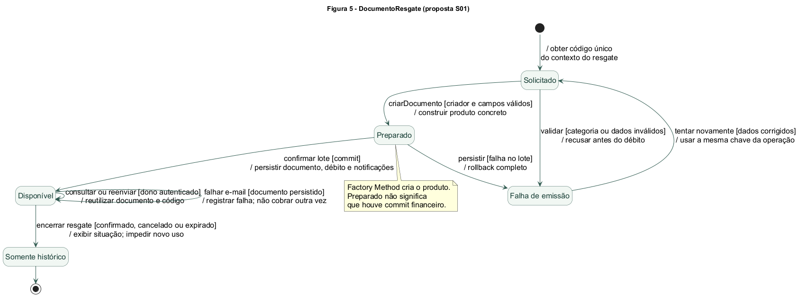
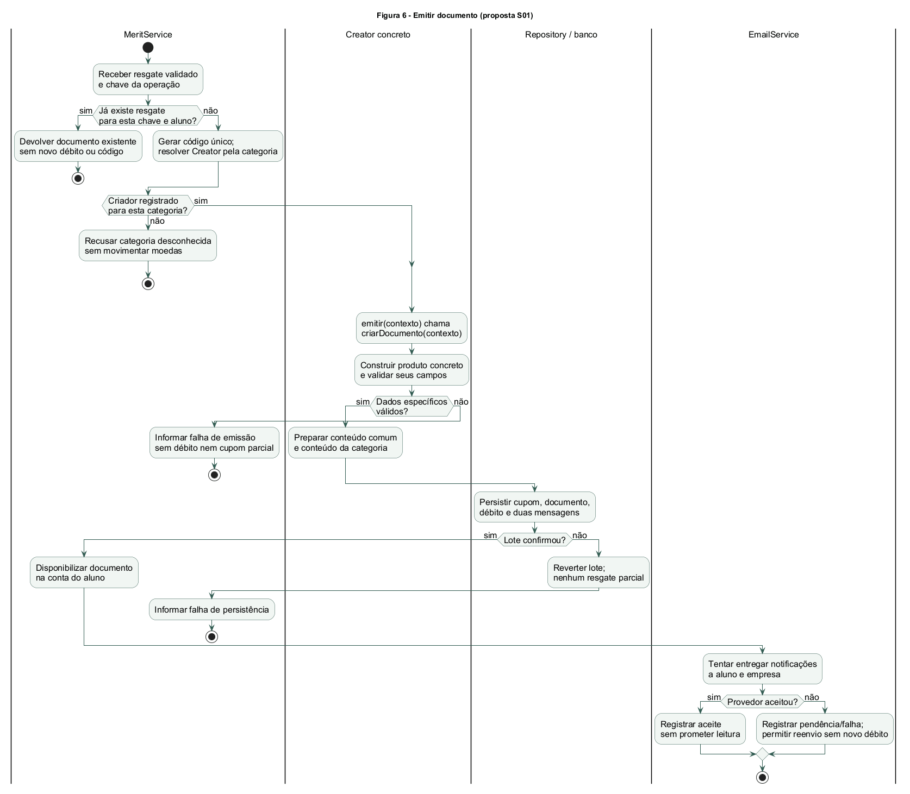

# Meritus | Lab05S01

**Release 3 - Seleção de funcionalidades e modelagem comportamental**

Engenharia de Software - Laboratório de Desenvolvimento de Software - PUC Minas. Documento de projeto preparado em 18/11/2026 para o repositório `vianadv/sistemaMoedaEstudantil`.

## 1. Escopo e escolhas

Esta entrega atende ao Lab05S01: três escolhas, análise do problema, responsabilidades, justificativa do padrão GoF, integração com a arquitetura existente e um diagrama de estados e de atividades para cada escolha. Os seis diagramas representam o comportamento proposto para a Release 3.

| Opção do enunciado | Escolha | Padrão GoF | Variação encapsulada |
|---|---|---|---|
| 2.2 | Políticas de benefícios | Strategy | Regra de cálculo do benefício |
| 2.3 | Ciclo de vida dos resgates | State | Comportamento permitido em cada estado |
| 2.4 | Cupons e comprovantes | Factory Method | Tipo de documento criado |

As escolhas se complementam: a política calcula o benefício; o resgate controla sua utilização; o criador produz o documento apropriado. Assim, cálculo, transições e construção não ficam concentrados em `MeritService` ou no controlador HTTP.

### Base real do projeto

O Meritus usa View em HTML/CSS/JavaScript, `AppController.api` para HTTP e autorização, `MeritService` para moedas e resgates, `Repository` como DAO e SQLite local ou D1 na Cloudflare. `emailTemplates` monta mensagens e `EmailService` tenta entregá-las após a gravação do negócio.

Hoje a vantagem possui custo fixo; o cupom possui os estados `available` e `used`; a validação presencial está no controlador; e os cupons usam um modelo comum. As novas abstrações descritas neste documento **ainda são propostas do S01**. Não são classes já existentes no repositório nem funcionalidades já publicadas.

### Limites da sprint

Não fazem parte desta entrega a implementação das três escolhas, novas telas, migração do banco ou mudança das regras do site em produção. O S02 detalhará classes, implantação e especificações; o S03 implementará e validará a evolução. Os materiais anteriores serão mantidos para comparação.

**Critério de conclusão do S01:** três análises completas e seis diagramas coerentes com elas. O PDF não exige implementar as seis opções apresentadas: o grupo deve escolher três.

As páginas dos diagramas usam formatos ampliados para preservar a leitura. As mesmas figuras estão disponíveis separadamente em SVG e PNG no repositório.

<!-- PAGEBREAK -->

## 2. Políticas de concessão de benefícios

**Opção 2.2 | Padrão Strategy, comportamental.**

### Problema identificado

O resgate atual usa diretamente `offer.cost`. Ao adicionar descontos percentuais, descontos em moedas e faixas progressivas, uma cadeia de condições dentro do resgate misturaria cálculo, validação de saldo, emissão e persistência. Uma nova política obrigaria a alterar esse fluxo central e aumentaria o risco de inconsistência entre catálogo e confirmação.

### Responsabilidades propostas

| Participante | Responsabilidade |
|---|---|
| `BenefitService` - contexto | Obter a política configurada, selecionar sua estratégia e produzir uma cotação |
| `BenefitPolicy` - contrato Strategy | Definir `calculate(offer, studentSnapshot)` e o formato do resultado |
| `PercentagePolicy` | Calcular benefício monetário percentual sem confundi-lo com o custo em moedas |
| `CoinDiscountPolicy` | Calcular redução fixa no custo de resgate em moedas |
| `ProgressivePolicy` | Aplicar uma faixa de redução no custo conforme o saldo anterior ao débito |
| `ConfiguracaoPolitica` | Guardar tipo, parâmetros, versão, empresa proprietária e situação da configuração |

### Por que Strategy

O problema envolve algoritmos alternativos que devem ser intercambiáveis por configuração. O contexto depende do contrato de cálculo, não de uma implementação específica. Uma nova regra é adicionada como estratégia e registrada por identificador; o fluxo de resgate continua consumindo uma cotação do mesmo formato. Isso evita subclasses de `MeritService` por política e condições de desconto espalhadas pela View.

### Regras e exemplos propostos

- **Percentual:** produto de R$ 40,00, desconto de 20% e custo de 80 moedas geram benefício de R$ 8,00; o débito permanece 80 moedas. Valores monetários são inteiros em centavos.
- **Desconto em moedas:** custo base de 80 moedas e redução de 20 resultam em débito de 60 moedas. Nenhuma estratégia pode produzir custo final inferior a uma moeda.
- **Progressiva:** com saldo anterior de pelo menos 200 moedas, a faixa de 10% reduz um custo de 80 para 72 moedas. Abaixo da faixa, o custo permanece 80. Arredondamento sempre para cima no custo final.

Percentuais são armazenados como inteiros em pontos-base: 20% corresponde a 2.000/10.000. Moedas e centavos são unidades distintas. A empresa configura apenas suas vantagens; parâmetros inválidos e tipos desconhecidos são recusados.

### Integração MVC e ciclo de vida

A View exibe a configuração e a cotação; o Controller valida sessão e propriedade; `BenefitService` calcula; `MeritService.redeem` revalida oferta, versão e saldo antes do débito atômico. O Repository persiste a configuração versionada e a cópia da cotação no resgate. A cotação aceita não muda quando a empresa edita a oferta.

O objeto do diagrama de estados é **ConfiguracaoPolitica**, não a execução do algoritmo: rascunho, ativa, inativa, substituída ou descartada. Publicar exige configuração válida e autorização. Alterar uma política publicada cria nova versão; consultar uma estratégia não muda seu estado. Ver Figuras 1 e 2.

<!-- PAGEBREAK -->

## 3. Ciclo de vida dos resgates

**Opção 2.3 | Padrão State, comportamental.**

### Problema identificado

O cupom atual admite apenas `available` e `used`, com conferência no Controller. Acrescentar expiração e cancelamento sem um modelo comum espalharia condições pelas rotas, permitindo decisões contraditórias sobre o mesmo resgate.

### Responsabilidades propostas

| Participante | Responsabilidade |
|---|---|
| `Resgate` - contexto | Manter o estado atual e delegar a solicitação de transição |
| `RedemptionState` - contrato State | Definir ações e recusar, por padrão, eventos não permitidos |
| Estados concretos | `Solicitado`, `AguardandoUtilizacao`, `Confirmado`, `Cancelado` e `Expirado` |
| `RedemptionService` | Carregar dados atuais, autorizar o ator e persistir a transição e seus efeitos em lote |
| `Repository` | Executar atualizações condicionais e manter débito, compensação e histórico consistentes |

### Por que State

O mesmo resgate muda de comportamento conforme sua situação. Cada estado concentra eventos e transições permitidos; estados finais recusam novos usos. A orquestração delega essas decisões. Strategy escolhe algoritmos; State representa a mudança de comportamento do próprio objeto.

### Transições e regras propostas

| Origem | Evento e condição | Destino e efeito |
|---|---|---|
| Solicitado | Oferta válida, saldo suficiente e lote confirmado | Aguardando utilização; débito, cupom e notificações |
| Solicitado | Rejeição ou desistência antes do débito | Cancelado; sem movimentar moedas |
| Aguardando utilização | Empresa proprietária confirma antes do vencimento | Confirmado; uso único |
| Aguardando utilização | Aluno proprietário cancela antes do vencimento | Cancelado; compensação única e invalidação do cupom |
| Aguardando utilização | Instante atual maior ou igual ao vencimento | Expirado; bloquear utilização |

Propõe-se validade de sete dias, registrada em UTC, com tempo do servidor. Cancelar cupom não utilizado devolve exatamente o débito por compensação vinculada à transação original, sem apagar o histórico. Expiração não devolve moedas automaticamente. Prazo e restituição são decisões propostas: o enunciado não as fixa.

### Integração MVC e consistência

`AppController` delegará `/api/coupons/validate` ao serviço de transições. A View oferece ações pertinentes; o servidor revalida estado, ator e prazo. Estado e efeitos financeiros são gravados atomicamente, verificando o estado anterior. Na disputa entre cancelar e confirmar, apenas uma transição vence.

Falha de e-mail mantém o cupom acessível, sem novo débito no reenvio. Consulta e uso verificam expiração. Solicitado representa a preparação anterior ao commit; rejeitá-la não debita moedas. A opção 2.6 não foi selecionada: não se propõe um gerenciador geral de comandos ou estornos administrativos. Ver Figuras 3 e 4.

<!-- PAGEBREAK -->

## 4. Emissão de cupons e comprovantes

**Opção 2.4 | Padrão Factory Method, criacional.**

### Problema identificado

Hoje `MeritService.redeem` gera um cupom comum e `couponTemplates` monta dois textos. Incluir documentos de restaurante, mensalidade e produto diretamente nesse fluxo criaria construções específicas e condições por categoria na mesma classe que verifica saldo. Novas categorias exigiriam alterar a orquestração financeira.

### Responsabilidades propostas

| Participante | Responsabilidade |
|---|---|
| `DocumentoResgate` - Product | Contrato comum: validar dados, apresentar identificação e produzir conteúdo para exibição e e-mail |
| Produtos concretos | `CupomRestaurante`, `ComprovanteMensalidade` e `VoucherProduto` |
| `DocumentoCreator` - Creator | Oferecer `emitir(contexto)` e declarar o Factory Method `criarDocumento(contexto)` |
| Criadores concretos | Sobrescrever o método de fábrica para criar o produto de sua categoria |
| Registro de criadores | Associar categoria ao criador, sem instanciar produtos dentro do Controller |
| `MeritService` e templates | Usar o documento retornado e persistir conteúdo e notificações junto ao resgate |

### Por que Factory Method

O fluxo comum de emissão opera com o contrato de produto. As subclasses de Creator determinam qual documento concreto será construído. A diferença para uma fábrica simples é explícita: existe um método de criação sobrescrito pelos criadores concretos e utilizado pelo processo comum `emitir`. Um único `switch` que executasse todos os `new` não seria a solução proposta.

### Conteúdo específico de cada produto

- **CupomRestaurante:** código, empresa, benefício percentual ou monetário calculado, validade e instruções de uso no estabelecimento.
- **ComprovanteMensalidade:** código, valor do benefício em centavos, identificação do aluno, instituição e instruções de aplicação.
- **VoucherProduto:** código, identificação e quantidade do produto, empresa, validade e instruções de retirada.

Todos recebem o mesmo identificador do resgate e o código gerado uma única vez pela orquestração. A repetição da chave de uma operação já confirmada devolve o documento existente; não gera outro código ou débito. A categoria e os dados obrigatórios são validados antes do commit. Categoria sem criador registrado é recusada.

### Integração MVC e ciclo de vida

A empresa selecionará a categoria na View de vantagens. O Controller validará os dados; `MeritService` resolverá o Creator; `emitir` chamará `criarDocumento`; e o Repository gravará o documento e a cópia do benefício com o resgate e as mensagens. As telas e os e-mails usarão o mesmo código e os mesmos dados persistidos.

O objeto do diagrama de estados é **DocumentoResgate**: solicitado, preparado, disponível, falha de emissão e somente histórico. Esses são estados do documento; a permissão de usar o benefício é sempre decidida pelo estado do resgate. Preparação não significa débito confirmado. O documento só fica disponível após o commit. Um erro anterior reverte o lote; um erro posterior de e-mail mantém o documento disponível para consulta e reenvio.

O documento proposto pode ser apresentado no sistema e em texto no e-mail; o enunciado não impõe um formato de arquivo. Seu Factory Method cria objetos de domínio, não apenas escolhe um texto de mensagem. Ver Figuras 5 e 6.

<!-- PAGEBREAK -->

## 5. Integração, critérios e apresentação

### Pontos de integração com o código atual

| Componente atual | Evolução proposta para as próximas sprints |
|---|---|
| `src/views/app.js` | Configuração da política/categoria, cotação, status, prazo e ações permitidas |
| `AppController.api` | Preservar autenticação e propriedade; delegar cálculo e transições |
| `MeritService.redeem` | Integrar Strategy, State e Creator sem misturar suas responsabilidades |
| `Repository` e D1/SQLite | Persistir versões, cotação, documento, prazo e compensação com integridade |
| `emailTemplates` / `EmailService` | Consumir dados do documento persistido; entregar após o commit |

O cálculo deve ser revalidado no servidor, considerando a versão da oferta e o saldo usados na cotação. Uma mudança concorrente invalida a confirmação e pede nova cotação. A transição deve usar atualização condicional do estado anterior. Cancelamento deve ter compensação única, vinculada ao débito original. São condições para a implementação, não garantias já presentes no site.

O S02 deverá especificar as colunas adicionais e a migração do `CHECK` de status. Os cupons atuais `available` e `used` serão preservados, com correspondência para aguardando utilização e confirmado. Não serão refeitos débitos, códigos ou e-mails antigos. Vantagens existentes precisarão de política padrão compatível com seu custo fixo. Nada disso é aplicado ao banco nesta entrega S01.

### Critérios de aceite previstos para a implementação

1. Uma política nova pode ser registrada sem alterar o fluxo financeiro de resgate.
2. Nenhuma cotação mistura centavos com moedas, produz custo negativo ou usa dados da View como fonte de verdade.
3. Confirmar duas vezes ou confirmar após cancelar/expirar é recusado, sem efeito financeiro adicional.
4. Cancelamento elegível devolve uma única vez o valor debitado e mantém os dois registros ligados.
5. Cada categoria cria um documento com campos próprios; aluno e empresa recebem o mesmo código.
6. Falha de e-mail não desfaz o negócio; repetição da operação não gera cupom ou débito adicional.

### Roteiro curto de apresentação do S01

Apresentar primeiro o fluxo atual do Meritus e o motivo das três escolhas. Explicar a separação: Strategy calcula, State controla transições e Factory Method cria documentos. Percorrer os estados e o fluxo alternativo de cada funcionalidade. Encerrar mostrando onde cada padrão será integrado ao MVC e quais decisões serão detalhadas no S02. Não apresentar a modelagem como código já implantado.

### Referências e observações

- Enunciado fornecido: `LABDESENV_5.pdf`, opções 2.2 a 2.4 e seção 4.1, páginas 1 a 4. O cabeçalho diz Laboratório 3 e a seção de apresentação menciona Release 2; o escopo adotado é o processo explicitamente identificado como Release 3 / Lab05S01.
- Gamma, E.; Helm, R.; Johnson, R.; Vlissides, J. *Design Patterns: Elements of Reusable Object-Oriented Software*. Addison-Wesley, 1994. Padrões Strategy, State e Factory Method.
- Código-base consultado: commit `82a4d53` do repositório Meritus, anterior à adição desta entrega de modelagem. Modelos da Release 2 e arquitetura foram usados como referência de integração.
- Notação: UML com PlantUML. Eventos de estado usam `evento [guarda] / efeito`. As raias dos diagramas de atividades identificam o responsável pela ação.

<!-- DIAGRAM: 01-politicas-estados -->

## Figura 1. Estados da configuração de política

Objeto relevante: ConfiguracaoPolitica. Publicar, desativar, reativar e substituir exigem autorização da empresa proprietária. Uma versão publicada não é editada em silêncio.

<!-- DIAGRAM: 02-politicas-atividades -->

## Figura 2. Atividades do cálculo de benefício

Precondição: uma empresa já configurou uma política válida para a vantagem. A cotação exibida é uma prévia; o resgate revalida os dados antes de debitar.

<!-- DIAGRAM: 03-resgate-estados -->

## Figura 3. Estados do resgate

Solicitado é a preparação anterior ao commit. Confirmação, cancelamento e expiração são mutuamente exclusivos; o histórico permanece após o estado final.

<!-- DIAGRAM: 04-resgate-atividades -->

## Figura 4. Atividades da transição de um resgate

O fluxo cobre os eventos de confirmar, cancelar e verificar vencimento. A guarda e a gravação condicional impedem duas transições concorrentes sobre o mesmo estado anterior.

<!-- DIAGRAM: 05-documentos-estados -->

## Figura 5. Estados do documento de resgate

Disponibilidade depende do commit. Falha de transporte é independente da existência do documento. Somente histórico significa que o resgate foi encerrado; o documento não é apagado.

<!-- DIAGRAM: 06-documentos-atividades -->

## Figura 6. Atividades da emissão de documento

Os criadores concretos sobrescrevem o Factory Method. O lote reúne cupom, débito, documento e duas notificações; o serviço de e-mail é acionado depois.

