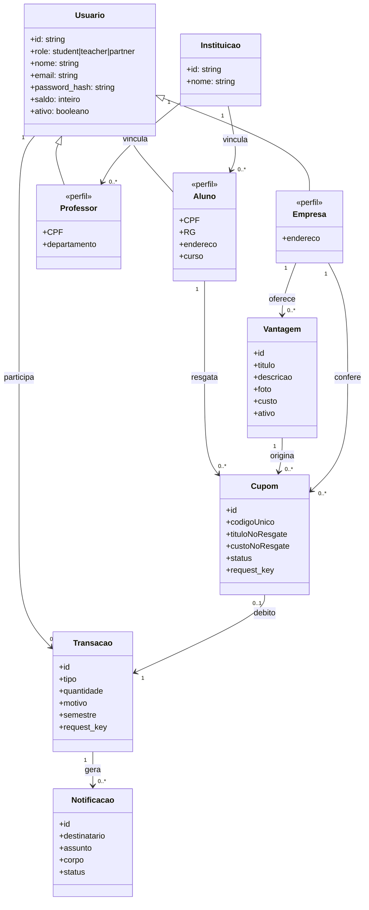
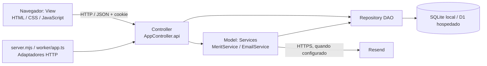

# Modelos - versão proposta 01

Estes modelos foram organizados nesta entrega como evolução proposta; não comprovam datas ou participação anterior.

## Classes do domínio conceitual

Os três perfis compartilham users.role na implementação. As especializações abaixo são conceituais, não classes concretas do código.

## Componentes / arquitetura

