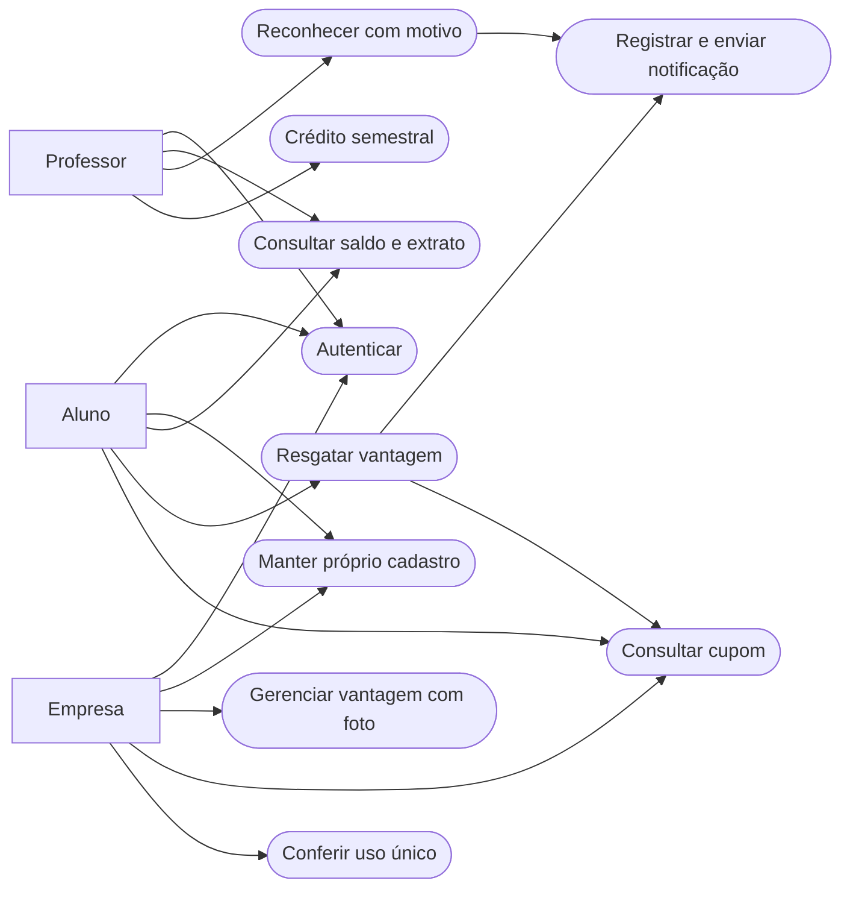

# Casos de uso finais

O arquivo `casos-de-uso.puml` contém a notação UML formal. Esta versão Mermaid é uma visualização navegável no GitHub.

Pré-condição dos casos de uso de negócio: usuário autenticado e autorizado. Exceção: cadastro e lista pública de instituições. Envio externo depende de configuração do provedor.
